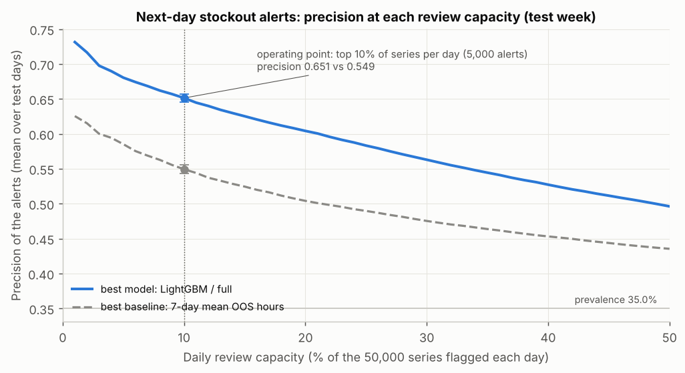
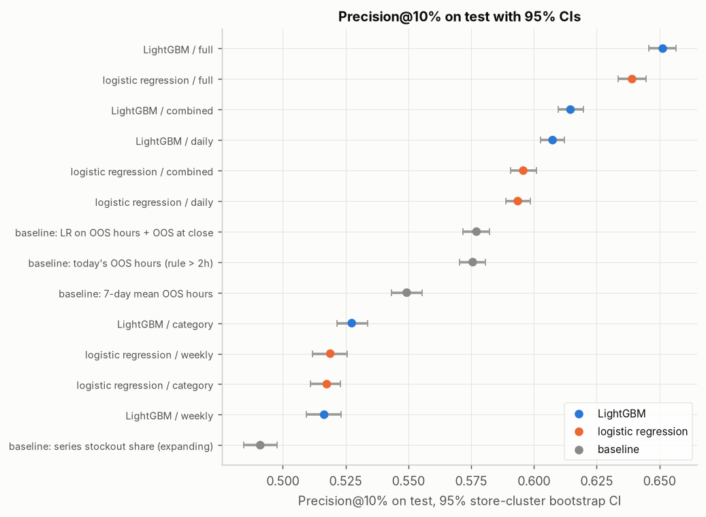
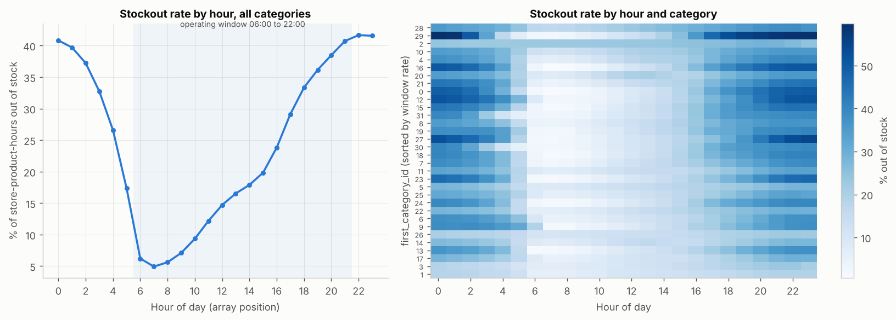
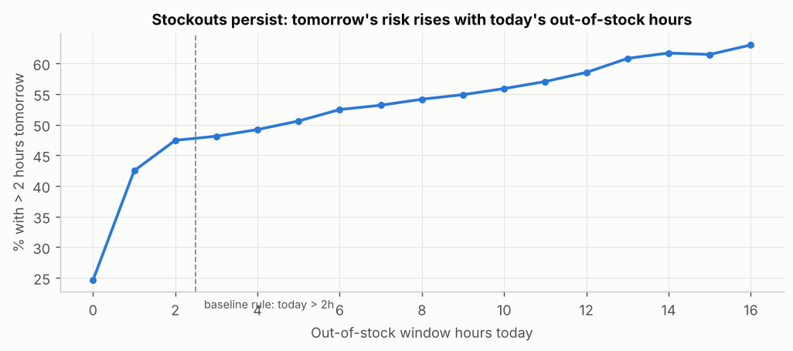
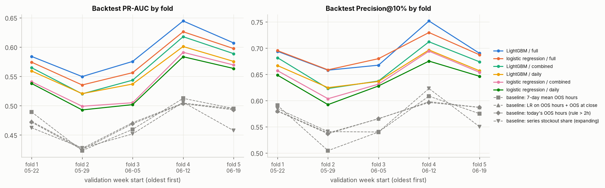
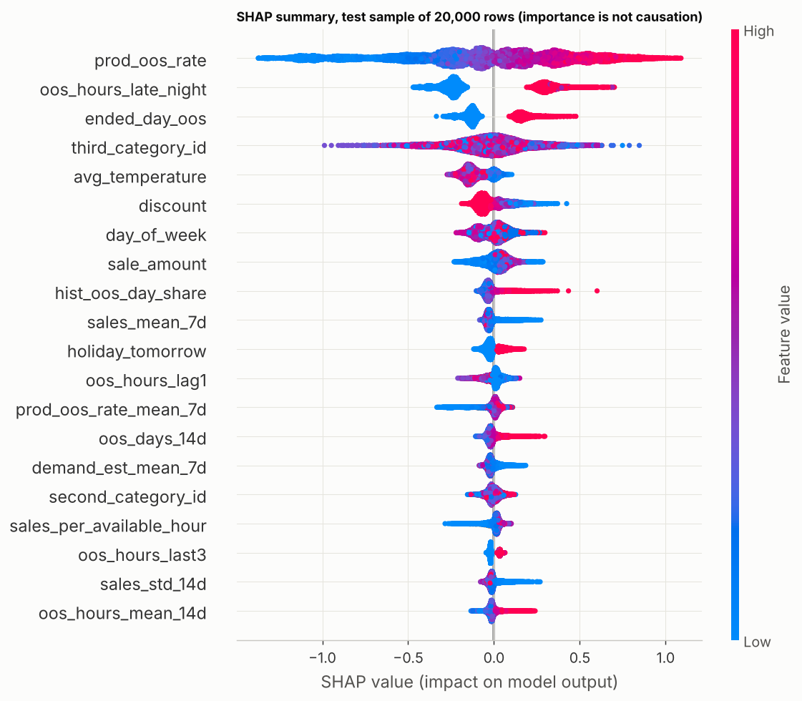
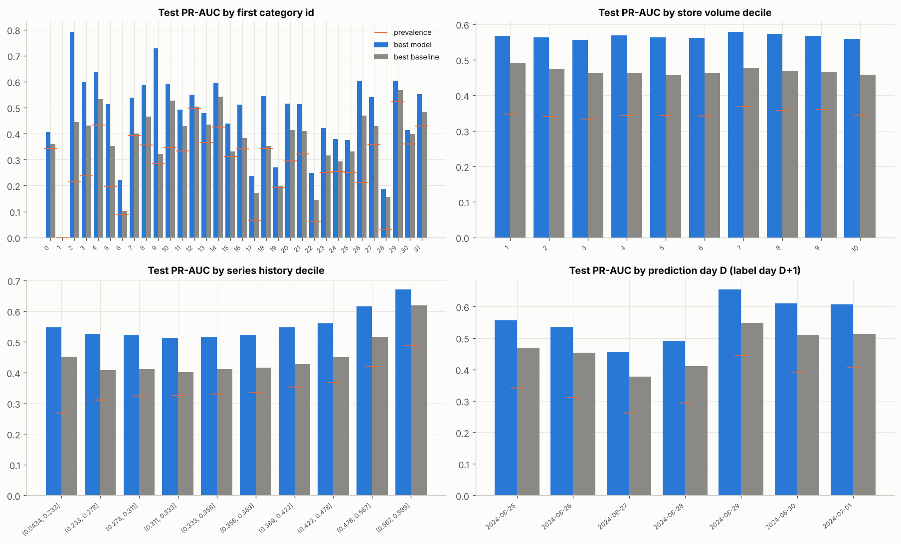
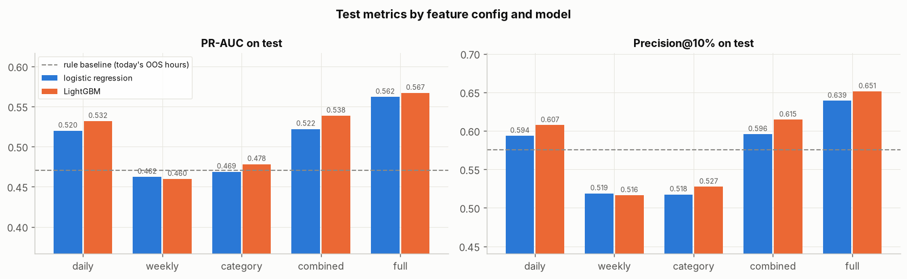

# Next-day stockout alerts for perishable goods

[](https://github.com/JacobWillson13/freshretail-stockout-prediction/actions/workflows/ci.yml)


Ranks 50,000 store-product series (898 stores, public
[FreshRetailNet-50K](https://huggingface.co/datasets/Dingdong-Inc/FreshRetailNet-50K) data) by
their risk of running out of stock tomorrow. The ranking for day D uses only what is known at the
end of D, so a replenishment team reviewing the top of the list has the night and the next
morning to act.

**Stack:** SQL feature pipeline (DuckDB), LightGBM and logistic regression, rolling-origin
backtest, store-cluster bootstrap CIs, calibration, SHAP, a scoring CLI, pytest with a leakage
test, GitHub Actions.



## Key results

On the held-out test week (7 days x 50,000 series, 35.0% of rows are stockouts):

- **If a team reviews the top 10% of series each day (5,000 alerts), 65.1% of alerts are real
  stockouts**, against 54.9% for the best simple baseline and 57.6% for the rule "out of stock
  more than 2 hours today".
- The gain over the baseline is +0.102 precision@10% (95% CI 0.096 to 0.108) and holds in each
  of 5 backtest weeks.
- The most useful signals: whether **the same product is running out in other stores today**,
  and whether **the shelf was still empty late at night** (22:00 and 23:00).
- The model is a ranking aid, not a high-accuracy oracle. It catches about 19% of tomorrow's
  stockouts at that capacity, and it is weak in categories where stockouts are rare.

| Model | Precision@10% | Recall@10% | PR-AUC | ROC-AUC |
|---|---|---|---|---|
| Baseline: 7-day mean out-of-stock hours | 0.549 (0.543 to 0.555) | 0.159 | 0.466 (0.462 to 0.471) | 0.636 |
| Baseline: today's out-of-stock hours | 0.576 (0.570 to 0.581) | 0.166 | 0.470 (0.467 to 0.474) | 0.649 |
| LightGBM, daily features only | 0.607 (0.603 to 0.612) | 0.176 | 0.532 (0.528 to 0.536) | 0.699 |
| **LightGBM, all features** | **0.651 (0.646 to 0.656)** | **0.189** | **0.567 (0.563 to 0.571)** | **0.729** |

Precision@10% is the share of real stockouts among the top 10% of series by score each day,
averaged over the test week. Brackets are 95% confidence intervals from a bootstrap over stores
(1,000 resamples). The PR-AUC of a random ranking equals the stockout rate, 0.35. Every model
and baseline is in `reports/tables/test_metrics_ci.csv`.



## The problem

- **Data:** hourly sales and stock status for 50,000 store-product series of perishable goods,
  one row per series per day. 90 days of training data (2024-03-28 to 2024-06-25, 4.5M rows)
  followed directly by a 7-day evaluation set (2024-06-26 to 2024-07-02), used as the test week.
- **Target:** for each series and day D, will D+1 have **more than 2 out-of-stock hours between
  06:00 and 22:00**? A single short gap can be a counting or restocking artifact; three or more
  hours is about a fifth of the selling day. 35 to 37% of rows are positive.
- **Why ranking:** at the threshold that maximizes F1, the model flags about half of all series
  every day, more than any team could check. So results are reported at a fixed daily review
  capacity instead.

## What the data shows

**Stockouts build through the day and stay high overnight.** Fewer than 10% of
store-product-hours are out of stock in the morning. By 21:00 it is about 40%, and it stays
there overnight. The target only counts 06:00 to 22:00, but the late-night hours of day D are
known at the end of D, and they became the second strongest signal.



**Stockouts persist.** A series with no out-of-stock hours today has about a 25% chance of a
stockout tomorrow; one that was out for the whole selling day has about 63%. That is why "tomorrow looks like
today" is a hard baseline to beat.



## How it works

**Pipeline.** Numbered SQL models in `sql/`, run in order by DuckDB, one model per file:
staging, then a single unnest of the 24-hour arrays, then daily stock metrics, the target, the
feature tables and the model dataset. The SQL stays close to BigQuery Standard SQL.

**Features**, all known at the end of day D:

| Group | Examples |
|---|---|
| daily | today's out-of-stock hours, longest run, sales, discount, weather, lags, 7 and 14 day rolling stats |
| weekly | totals for the last completed Monday to Sunday week |
| category | stockout rate and sales of the store's category, today and over 7 days |
| intraday | out of stock at closing, out-of-stock hours at 22:00 and 23:00, time of first stockout |
| history | the series' long-run stockout rate |
| entity | stockout rate of the same product in other stores, of related products in the same store, and of the whole store |
| demand | estimated demand and lost sales, correcting for sales that stop when the shelf is empty |

**Leakage control.** The only forward-looking field is tomorrow's holiday flag, a calendar fact.
`tests/test_leakage.py` scrambles all raw data after a cutoff, rebuilds the warehouse and checks
that no feature dated before the cutoff changes.

**Evaluation.**

- Model selection uses a 5-fold rolling-origin backtest over the training period. The test week
  played no part in choosing the model and was scored once.
- Thresholds and calibration are fitted on a validation split (the last 14 days of training).
- Confidence intervals come from a bootstrap that resamples whole stores, so series from the
  same store stay together.
- Baselines: today's out-of-stock hours, the 7-day mean, the series' long-run stockout rate,
  and a two-feature logistic regression.

## Model selection: backtest

Five weekly validation folds (weeks starting 2024-05-22 to 2024-06-19). Each fold trains on all
earlier days. Mean ± standard deviation over the folds:

| Model | PR-AUC | Precision@10% |
|---|---|---|
| **LightGBM, all features** | **0.592 ± 0.036** | **0.692 ± 0.037** |
| Logistic regression, all features | 0.578 ± 0.035 | 0.690 ± 0.026 |
| LightGBM, daily + weekly + category | 0.567 ± 0.038 | 0.666 ± 0.036 |
| LightGBM, daily features only | 0.559 ± 0.032 | 0.656 ± 0.028 |
| Best baseline: 7-day mean out-of-stock hours | 0.476 ± 0.035 | 0.564 ± 0.042 |

LightGBM with all features has the highest PR-AUC in every fold. Logistic regression on the
same features is level with it on precision@10% (ahead in three folds, behind in two), so most
of the gain comes from the features, not the model. Every
model and baseline is in `reports/tables/backtest_summary.csv`.



## What drove the gains

Removing one feature group at a time from the final model (LightGBM, test week):

| Group removed | Change in PR-AUC | Change in precision@10% |
|---|---|---|
| entity | -0.014 | -0.021 |
| intraday | -0.009 | -0.011 |
| history | -0.003 | -0.005 |
| demand | -0.0005 | -0.001 |

The entity and intraday groups carry the improvement. The history and demand groups add
little: their changes are within the run-to-run variation of about 0.003 PR-AUC.



The top features by SHAP are the product's stockout rate in other stores today, the late-night
out-of-stock hours, being out of stock at 23:00, the product category and average temperature.
Temperature follows the season, so part of its weight may reflect time rather than weather.
These describe what the model uses to rank risk, not what causes a stockout.

## Limitations

- **One test week.** The confidence intervals capture variation across stores, not across
  weeks. The backtest spread (PR-AUC sd 0.036) is the better guide to week-to-week variation.
  Validation scores are higher than test scores for every model, the baselines included, which
  suggests late June was a harder period.
- **Weak where stockouts are rare.** In category 28, 3.1% of rows are stockouts and PR-AUC is
  0.187. The model still beats the baseline in every store-size group and every
  stockout-history group.
- **Short history.** About 3 months of one retailer's data, so longer seasonal patterns are not
  covered.
- **Associations only.** Feature importance does not say what would happen if a discount were
  changed.
- **Calibration** fitted on validation lowers the test calibration error (ECE) from 0.037 to
  0.021, but predicted probabilities still average slightly below the observed rate.



More detail is in the model card, [`docs/MODEL_CARD.md`](docs/MODEL_CARD.md), and the analysis
notebook, [`notebooks/stockout_analysis.ipynb`](notebooks/stockout_analysis.ipynb).

## Side study: does aggregation level matter?

Using the same daily prediction rows, LightGBM on daily features reaches a test PR-AUC of 0.532,
on store-category features 0.478, and on last-week totals 0.460, which is below the one-line
baseline (0.470). Weekly features change once a week and cannot react to a stockout that started
today. Combining the three levels adds +0.007 PR-AUC over daily alone. The full grid is in
`reports/tables/aggregation_study_test.csv`.



## Reproduce

```bash
pip install -e ".[dev,notebook]"

make data        # download train and eval parquet from Hugging Face into data/raw/
make warehouse   # raw parquet -> DuckDB warehouse, ~2 min
make checks      # data quality checks
make backtest    # 5-fold rolling-origin backtest, ~45 min
make train       # final fit, thresholds, calibration, test scored once, ~45 min
make report      # bootstrap CIs, capacity curves, calibration, slices, SHAP, ~10 min
make all         # everything above, in order
make test        # pytest on synthetic data (also run in CI)

# ranked alert list for prediction day D (covers D+1)
python -m src.predict --date 2024-07-02 --top-k 5000   # -> reports/alerts/alerts_2024-07-02.csv
```

Runtimes are for a 4-core machine with 16 GB of RAM. If `make data` fails, download
`data/train.parquet` and `data/eval.parquet` from the
[dataset page](https://huggingface.co/datasets/Dingdong-Inc/FreshRetailNet-50K/tree/main/data)
into `data/raw/`.

## Repository layout

```
sql/        numbered SQL models, run in order by src/run_sql.py
src/        data loading, SQL runner, checks, modeling, backtest, metrics, calibration,
            reporting, scoring CLI (predict.py)
scripts/    dataset download
notebooks/  analysis notebook and the script that generates it
tests/      pytest on synthetic data: target, leakage, features, metrics, backtest, scoring
reports/    figures, tables and an example alert list
docs/       model card
```

## Data and citation

FreshRetailNet-50K is published by Dingdong Inc. under
[CC BY 4.0](https://creativecommons.org/licenses/by/4.0/). The tables and figures in `reports/`
are derived from it. No raw data is stored in this repository.

```bibtex
@article{2025freshretailnet-50k,
  title   = {FreshRetailNet-50K: A Stockout-Annotated Censored Demand Dataset for Latent Demand
             Recovery and Forecasting in Fresh Retail},
  author  = {Wang, Yangyang and Gu, Jiawei and Long, Li and Li, Xin and Shen, Li and Fu, Zhouyu
             and Zhou, Xiangjun and Jiang, Xu},
  journal = {arXiv preprint arXiv:2505.16319},
  year    = {2025}
}
```

## License

Code is released under the [MIT License](LICENSE). The dataset keeps its own CC BY 4.0 license.
